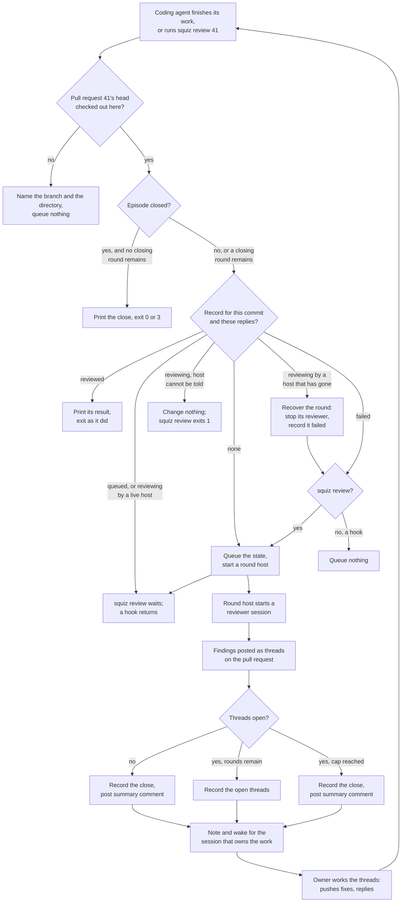
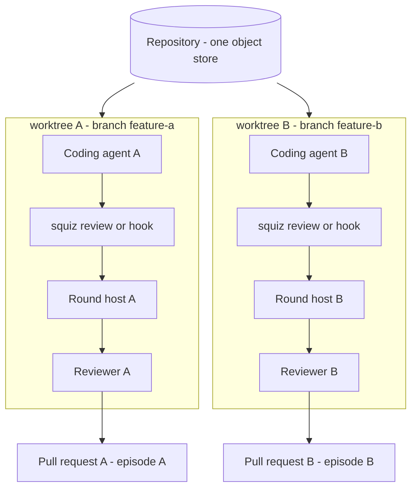

# 3. The loop

The loop runs the review from end to end. A coding agent finishes its work on a
pull request, or runs `squiz review <number>`, and a round starts: a reviewer
reads the change in a session of its own, and its findings go onto the pull
request as threads. The session that owns the work is told the result. It works
the threads, replies and pushes, and the next round starts, until nothing is
open or the round cap is reached.

**Every trigger asks for the same review.** `squiz review <number>`, the Claude
Code hooks, a coordinator and a CI job are each a trigger. A trigger queues the
pull request's state for review and makes sure a round host is running, and does
nothing else. The round host runs the round, outside every trigger's process.

**Nothing has to reach into the coding agent's session for the loop to close.**
The pull request holds the review, and `squiz review` prints it, so any coding
agent that can run a shell command can be reviewed. Where squiz knows the
session that owns the work, it also tells that session, as The report sets out
below.

## Terminology

| Term | What it is |
|---|---|
| **Round** | One review of one state of a pull request, its head commit and the replies on the reviewer's threads: gate, review, post, decide. A round either leaves threads open for the coding agent, whose next push or reply starts the next round, or ends the episode. |
| **Episode** | Every round belonging to one pull request in one worktree. The round cap, the local state file and the summary comment are all per-episode; the review itself is per-round. |
| **Closing round** | The one round an episode the round cap closed with threads open may still run, when a new commit or reply follows the close. It rules on the threads still open and raises nothing, and the cap does not count it (The round cap). |

An episode is **live** from its first round until it closes, and its reviewer is
reviewing or its coding agent is working on what the review said. It closes for
one of three reasons: nothing is left open for another round to work, the round
cap is spent, or a round reached the token bound. A round that failed closes
nothing — it posts a failure comment under [§ 7](failure-modes.md), and the episode stays live. An
episode the cap closed with threads open is closed, and may still run its closing
round, which closes it again (The round cap).

A live episode is one whose close has not been recorded. Nothing else makes an
episode live or over: not whether a round is running at this instant, because
between two rounds the coding agent is working and no round exists, and not how
long ago anything happened.

## The state file

**An episode is keyed by the number of its pull request.** Its state lives in
`.squiz/<number>/` inside the worktree. The state file holds the round count, the
cost of each round, what it reviewed and ruled, and whether it was the closing
round ([§ 5 The format](summary.md#the-format)), what the episode spent on attempts that were no round,
whether the episode has reported its close, what was open at that close and
whether that close leaves a closing round, and the reviewer's last ruling on each
thread. The directory also holds:

- `rounds/<k>/`, for each round: `prompt.md`, the task prompt the reviewer is
  handed, the report file the reviewer reports into, the reviewer's session,
  `resume.txt`, the command that resumes that session, and `gh/`, the empty `gh`
  configuration the reviewer runs with ([§ 4 Tools](reviewer.md#tools)). The snapshot the reviewer
  reads is in the temporary directory instead ([§ 4 The snapshot](reviewer.md#the-snapshot)).
- `notes/`, the notes for the sessions that own the work, under The report.
- `host.log`, the round host's output.
- `state.lock`, held while the state file is changed.

**`.squiz/` keeps itself out of git.** Each time squiz makes an episode's
directory, before it writes the state file, takes a lock or writes
`review.txt`, it also makes `.squiz/.gitignore` holding `*` where that file is
missing. Git then ignores `.squiz/` and everything in it, with no line in the
project's own `.gitignore`. A `.squiz/` made before squiz did this gains the
file on its next write. Squiz writes the file whole and links it into place, so
two processes making `.squiz/` at once both succeed and leave one file holding
`*`. A `.squiz/.gitignore` that is already there is left as it is, whatever it
holds.

**Every change to the state file is made under `state.lock`.** A writer takes the
lock, reads the file, changes it, writes it, and releases the lock. A trigger
queueing a state and a round host writing its reviewing record therefore cannot
drop each other's record. The lock is held for one update and never across a
review, and it is a different file from `host.lock`. It names its holder's pid
and start time. A lock whose holder has gone is taken over. A writer that finds
the lock held by a live process, or by one that cannot be told running or gone,
waits up to a deadline of its own and never breaks the lock. A wait that runs out
is a state file that cannot be written ([§ 7](failure-modes.md)). Readers take no lock, because every
write replaces the file whole.

**The state file also holds one record for each state of the pull request the
episode has reviewed.** A state is two things, read when a trigger starts:

- **The head commit**, as GitHub reports it for the pull request.
- **The latest activity on the reviewer's threads.** Activity is a reply from
  anyone other than the reviewer, on a thread the reviewer opened: a comment after
  the first in that thread, carrying no `**Squiz reviewer · ` marker. The coding
  agent's replies are activity, and so is a person's. A thread a person opened
  holds no activity, whatever is said on it. The latest activity is the GitHub
  identifier of the newest such reply on the pull request, or none. An edited
  reply keeps its identifier and changes nothing. A deleted one can change which
  reply is newest, and that is a change like any other.

A new commit or a new reply is a new state. Either one means the review on record
no longer covers what the pull request now says.

Each record is in one of five states:

| State | What it records |
|---|---|
| Queued | A trigger asked for a review of this state, and no round has started it yet. |
| Reviewing | The round host running the round, and when that process started. A pid alone is reused, so the start time is what tells the round that holds it now from one that held it before. Also the round's number `k`, from the moment the round starts. Once the reviewer starts, also the reviewer's session: its backend, its pane or window where it has one, its pid and start time, the moment its time bound runs out, and its snapshot. |
| Reviewed | The result the round reached: its exit status, and the threads it left open. A round that left nothing open while a later state was queued behind it reached no close, so it records the result *reviewed clean, episode open*, with no exit status. Also the round's number `k`, which names its directory `rounds/<k>/` and so its `resume.txt`, when the round started and ended, and the reviewer's backend and pane or window. A round that left the episode open also records each of its findings that no thread holds, as the line [§ 5](summary.md)'s Notes would give it. The closing round's record says it was the closing round. |
| Failed | The reason the round failed, and whether its owner has been sent a note about it. Also the round's number `k` and when the round started and ended, where a round started, and the reviewer's backend and pane or window, where a reviewer started. |
| Not reviewed | The episode closed before a round took this state, or a later commit or reply superseded it before its round started, and why. |

A record also names the session that owns the work, where a trigger knew it:
the session's identifier, the subagent that did the work where one did, and the
session's messaging socket where the hook found one. The Claude Code hooks
record it, and `squiz review` records none.

A record also carries the Herdr workspace the trigger ran in, from the
`HERDR_WORKSPACE_ID` in its environment, where it has one. Herdr sets it in every
pane it manages, so a hook or a `squiz review` run from the coding agent's pane
finds the coding agent's workspace. The reviewer's tab opens there ([§ 4 The
reviewer session](reviewer.md#the-reviewer-session)). A workspace id is a `w` and a number, such as `w2`. A value of any other shape
is not recorded, and the tab opens in the focused workspace.

**A trigger reads the record for the pull request's state before it queues
anything.** It has looked up the pull request and listed its threads by then,
because the state is read from them.

- **No record:** the trigger queues the state, and starts a round host where
  none is running.
- **Failed:** a hook queues nothing. `squiz review` queues the state again,
  because running the command is the request to retry it.
- **Reviewing**, by a round host that has gone: the trigger recovers the round, as
  The round host sets out, which records it failed. It then does what it does for
  a failed state.
- **Queued:** the trigger queues nothing, and starts a round host where none is
  running.
- **Reviewing**, by a round host that is running: the trigger queues nothing.
- **Reviewing**, by a round host no one can tell running or gone: the trigger
  recovers nothing, queues nothing and starts nothing, because recovering a round
  whose host may be alive would stop a live reviewer and remove its snapshot.
  `squiz review` exits 1 naming the host it could not check, and a hook returns.
  The next trigger checks again.
- **Reviewed, or not reviewed:** the trigger queues nothing. `squiz review`
  returns that result, with the threads read from the pull request as they stand
  now.

`squiz review` then waits, as [§ 7](failure-modes.md) sets out, and the hooks return at once.

**A failed state is retried only on a fresh request.** A new commit or a new
reply is a new state, with no record, and is queued like any other. The same
state is retried only by someone running `squiz review`. A hook firing on a
state that failed queues nothing, so a turn the coding agent spent reading a
failure note does not bring the failure back. Failures that spend no round, such
as a reviewer that will not start or a `gh` that cannot run, follow the same
rule.

**No failure starts a cycle.** A retry by `squiz review` that fails again posts
its failure comment, returns exit 1 to the run that asked for it, and writes no
second note. So every attempt after the first needs someone to run the command,
and a run that gets exit 1 is told not to run it again ([§ 9](adoption.md)).

**Every trigger therefore gets one review per state.** A second trigger for a state
already queued or under review finds it and queues nothing, so two firings for one
commit and the same replies post one set of threads and at most one summary. One
episode runs one round at a time. A state queued while a round of an older one runs
is reviewed next.

**A state accepted into the queue is never dropped.** It is reviewed, or it is
given a result of its own. Say state A is under review and state B, a later
commit, is queued behind it:

| A's round ends with | What happens to B |
|---|---|
| Threads open, rounds remaining | B is reviewed next, as usual. |
| Nothing open, rounds remaining | The episode does not close. A is recorded as *reviewed clean, episode open*: no exit status, no summary, and no note for its owner. B is reviewed next, and the episode closes from the last round with nothing queued behind it. A run of `squiz review` waiting on A goes on waiting, for the state the queue ends on, and returns that state's result: 0 or 3 with the close, or 2 where B left threads open. It exits 4 where its wait runs out first. |
| The round cap reached, or the token bound | The episode closes, as it must, and posts its summary. Its Notes name the cap or the bound and each state left not reviewed, whether A left threads open or nothing. B is recorded as not reviewed, with the reason. A run of `squiz review` waiting on B is handed the close, exit 0 or 3, with a line saying why B was not reviewed, and B's owner gets a note saying the same. |

The line comes right after the heading of the close the run is handed:

```
Full output, to read where this is cut short: /work/squiz/.squiz/41/review.txt
Squiz reviewed PR #41 at 3f9c2e0: round 3 of 3, no new findings.
Squiz did not review PR #41 at 8d21a4f: the episode closed at the round cap, after reviewing 3f9c2e0.
```

Where the token bound closed the episode, its reason reads "the episode closed at
the token bound, after reviewing 3f9c2e0".

**A round reviews the pull request's newest state, and only that.** When its
round starts, the round host checks that the state it took is still the pull
request's: the same head commit and the same latest activity. A state the pull
request has moved past is superseded. No review runs for it, nothing is posted,
and it is recorded not reviewed with a reason naming the state that superseded
it, in the form [§ 5](summary.md)'s Notes use:

```
superseded by 8d21a4f
superseded by 3f9c2e0 with different replies
```

The newer state is queued by a trigger, and reviewed in its turn. The round host
queues nothing. Usually the trigger that read the newer state queues it. The host
can be the first to read it, though: GitHub can answer a trigger run straight
after a push with the head from before the push, and answer the host a moment
later with the pushed one. A run of `squiz review` waiting on the superseded
state then queues the newer one, as below. A hook does not wait, so a state
superseded after a hook queued it is queued by the next trigger. The state a
round reviews is the one its result is recorded against: the reviewer reads a
snapshot of that state's head commit ([§ 4 The snapshot](reviewer.md#the-snapshot)).

The record also holds the head commit and latest activity of the state that
superseded it, because the reason names that state only by its short commit, and
other states can share a commit.

A run of `squiz review` whose own state was superseded goes on waiting, for the
state with that head and activity, and returns that state's result. Where that
state was superseded in turn, the run follows it to the next. Where the state it
follows has no record, the run triggers again: it reads the pull request's state
afresh and acts on its record as any trigger does, which queues a state with no
record and starts a round host. Where it read the state it was following, it goes
on following it. Where it read another, it waits on that one instead. It exits 4
where its wait runs out first, as [§ 6](commands.md) shows.

**A round decides its close and records it in one step.** It reads the queue
under `state.lock`, decides from it as the table above sets out, and writes the
close in that same update, before it posts the summary. A trigger that comes
after the close finds it and queues nothing, so no state queued while the
summary is posted is stopped by a close it arrived before. A round that finds
the round cap or the token bound already spent, and closes the episode without
starting a reviewer ([§ 5](summary.md)), also writes the close before it posts the summary.

**A state left not reviewed is named by its short head commit, and by its
replies where an earlier state has the same commit.** The earlier states are the
one the round that closed the episode reviewed and those queued ahead of it. A state with the head
of an earlier state differs from it only in its replies: a reply was added or
deleted, and the record cannot say which. Such a state is named "with different
replies". A state whose head two earlier states have is named "with different
replies a second time", one with three "with different replies a third time", and
so on. Where B has A's commit and different replies, the line reads:

```
Squiz did not review PR #41 at 3f9c2e0 with different replies: the episode closed at the round cap, after reviewing 3f9c2e0.
```

**A reply is ruled on even where no commit follows it.** A coding agent that
disputes a finding and pushes nothing asks for a review again on a new state, and
the round reads its reply and rules on the thread: `withdrawn` where the argument
holds, `open` where it does not. A reply posted while a round runs is not in that
round's state, so the next run reviews again.

**Every round counts against the round cap, whatever started it.** A round that a
reply started is a round, exactly as one a commit started. A coding agent that
answers every finding with a dispute spends the cap doing so, and the episode
closes at the cap with the disputes for a person. A run that returns a recorded
result is no round and spends nothing.

**The state file keeps the reviewer's last ruling on each thread it ruled on**,
by the thread's node id: `fixed`, `withdrawn` or `open`. GitHub's resolved state
says a thread is closed and not which verdict closed it, and a close that runs no
reviewer counts the thread by this ruling ([§ 5](summary.md)). A round writes its rulings in
the update that records its cost, before it posts anything, each in place of the
one its thread held before. A state file that will not take that update fails
the round with nothing posted, so no verdict reaches a thread unless its ruling
is on record. A thread a finished review gave no verdict is kept as `open`,
which is the verdict it is treated as. A failed round writes the rulings it
salvaged, and leaves every other thread's alone. A ruling is kept whether or not
GitHub then takes it, because the thread's resolved state still says whether it
is closed. A state file with no rulings holds none.

**A closed episode stays closed in its worktree.** The one exception is the
closing round, which a close at the round cap leaves for the next new state (The
round cap). A second episode on the same pull request starts in another worktree
on the same branch, which holds no state for it.

**A state file an earlier version wrote may also hold what its rounds found by
comparing the snapshot before and after the reviewer ran.** It reads as it would
without that, and nothing reports what it held.

## End-to-end workflow



## A round, step by step

1. **Gate on the pull request.** The trigger looks up pull request `<number>`
   and checks that its head branch is the branch checked out in the directory it
   was run in, and the round host checks again when the round starts, together
   with whether a later state has superseded the one it took (The state file).
   If the pull request is not open, or that directory has another branch or a
   detached HEAD, no review runs and nothing is posted. `squiz review` exits 1, and stderr names
   what it found:

   ```
   squiz: no review ran: PR #41's head is "feature-a", and "/work/squiz" has "main" checked out
   ```
2. **Gate on the episode and the commit.** The trigger reads the episode's state
   file. An episode that has reported its close is over: `squiz review` prints the
   close and exits as the close did, and no reviewer runs. The round cap and the
   token bound are not consulted, because an episode that is over stays over
   whatever a bound would now allow. An episode whose closing round remains is
   the one exception, and a new state is queued for that round (The round cap). Otherwise the trigger lists the threads, and
   the record for the pull request's state decides, as The state file sets out,
   whether the state is queued.
3. **Run the reviewer.** The round host starts the reviewer as a session of its
   own ([§ 4](reviewer.md)), hands it the pull request for scope and intent together with
   the threads the reviewer itself opened on it, and lets it read directly its
   snapshot of the head commit of the state it took: files the diff did not touch, callers, and git history.
4. **Post the findings, and act on the verdicts.** Each new finding opens a new
   review comment thread, anchored to a file and a line or to a file as a whole.
   Each verdict the reviewer returned is applied to the thread it names: `fixed`
   and `withdrawn` reply on an open thread and then close it, and `open`
   re-opens the thread or leaves it open, then posts the reviewer's reason as a
   reply on it. [§ 4 Findings](reviewer.md#findings) gives each reply.
5. **Record the open threads, or close.** If threads of this review are still
   open and the round cap has not been reached, the round records the result. A
   run of `squiz review` waiting on it prints the open threads and exits 2, and the
   round tells the session that owns the work (The report). A thread a person opened is counted by neither the arithmetic
   nor the output, so it never keeps the loop going and an episode ends with one
   still open. [§ 6](commands.md) shows what is printed.
6. **Close the episode.** Otherwise, and where nothing is queued behind this
   round or the cap or the token bound is reached, the round records the close in
   the episode's state, in the same update that read the queue, and then posts
   one summary comment on the pull request. A state still queued is handled as
   the table above sets out. A run of
   `squiz review` exits 0 where nothing of this review is open, and 3 where the
   round cap or the token bound closed it with threads still open, which it
   prints. What remains open is what
   the summary reports and what a person then looks at.

Where threads are open, the coding agent works them before it asks for another
review. It replies on a thread to say what it changed, to disagree, or
to ask a question. It does not close threads. A thread closes when the reviewer's
verdict closes it, so a closed thread means the reviewer read the code as it now
stands and accepted it. A thread the reviewer keeps open carries its reply
saying what is still wrong, so a dispute reads on the thread as a conversation:
the reviewer, the coding agent, the reviewer again, until the thread is closed
or the round cap leaves it open.

## The round cap

The cap defaults to 3 and is settable from 1 to 8. A cap of R hands open threads
back to the coding agent at most R−1 times, because round R closes the episode
whatever is still open. A cap of 1 reviews once and closes.

**An episode the cap closed with threads open runs one closing round, when a new
state follows the close.** Round R closes the episode as any close does: it
records the close, posts the summary, and a run of `squiz review` waiting on it
exits 3. The update that records the close also records that the closing round
remains, so a trigger that reads the state while the summary is posted already
finds it. The first new state after that, a new commit or a new reply on the
reviewer's threads, has no record, so a trigger queues it as it queues any state
with no record, and the round host runs it as the closing round. A trigger
that finds the same state as before finds its record, and queues nothing.

The closing round is a round as A round, step by step sets out, with five
differences:

- **It rules only on the threads still open.** It hands the reviewer the
  reviewer's threads that are not resolved, and no others, so no verdict can
  re-open a resolved one. A thread it is not handed keeps its state, and the
  summary counts it by the ruling the state file recorded for it, as a close
  before any review does ([§ 5](summary.md)): `fixed` or `withdrawn`, or resolved with its
  ruling unknown where none was recorded.
- **It raises no findings.** Its prompt says so, in a section of its own before
  the threads:

  ```markdown
  ## Closing round

  The round cap is spent, and this is the review's closing round. Return a verdict on every thread below, and report no findings: a finding reported in this round is not posted.
  ```

  The round does not rely on the reviewer to obey. A finding the reviewer reports
  anyway is never posted, and no thread is opened for it. The round names each
  one in its summary's Notes, on `squiz review`'s stderr, and under its line in
  `squiz status`, so a finding dropped this way is never lost without a line
  saying so. A closing round that fails names them in its failure comment
  instead of a summary, and on the other two all the same.
- **The cap does not count it.** Its entry in the state file is marked as the
  closing round. The cap's arithmetic leaves that entry out, and every other
  ledger keeps it: its spend is the episode's, its directory is `rounds/<k>/`
  with the next `k`, and its reviewer's label is `squiz-<number>-r<k>`.
- **It closes the episode for good.** It writes the close again, in the update
  that reads the queue, and posts a second summary comment ([§ 5](summary.md)). A run of
  `squiz review` waiting on it exits 0 where it left nothing open, and 3 where it
  left threads open. A state queued behind it is recorded not reviewed, as one
  queued behind a round that reached the cap is, with the reason "the episode
  closed at the round cap, after reviewing" and the closing round's commit.
- **The token bound is checked before it, as before any round.** Where the
  episode's widest attempt has reached the bound, which only a bound lowered
  since the close can bring about, no reviewer runs, nothing is posted, and the
  state is recorded not reviewed with the reason "the episode had closed before a
  round took this state".

**The closing round runs once per episode.** It is spent once its entry is in the
state file, which happens when its reviewer has run, however that review ended.
The entry is written before the round posts, so a trigger for the state the
closing round took finds that state's record still reviewing, and waits on it as
on any state under review. A
closing round the time bound cut short is spent, and so is one whose review
failed after the reviewer reported. After it the episode is over as any closed
episode is: a fix pushed after the closing round queues nothing, the threads it
left open are a person's, and `squiz review` prints the close and exits 3. A
closing round that failed after it was spent posts its failure comment, which
says "The review is closed: its closing round has run. No round runs again." in
place of the retry, and posts no second summary.

**A closing round that spent nothing is a failed state like any other.** A
reviewer that would not start, or a `gh` that could not answer before the
review, records no entry. A hook does not retry that state, and `squiz review`
or a new state does, as The state file sets out.

**Only a round that reviewed and reached the cap leaves a closing round.** A
close at the token bound leaves none, and so does a close before any reviewer
ran ([§ 5](summary.md)). A state queued behind the round that reached the cap is recorded not
reviewed at that close, as The state file sets out, and only a state after the
close starts the closing round.

## What starts a round

**A round starts when a trigger queues a state and the round host takes it.**
There are two kinds of trigger:

- **The plugin's hooks**, on `Stop` and `SubagentStop`, which queue the state
  and return at once. Claude Code and the GitHub Copilot CLI both fire them, as
  The Claude Code hooks sets out. In either runtime they start every round, and
  the session that owns the work is woken with the result, as The report sets
  out.
- **`squiz review <number>`**, which waits for the review and prints the result.
  The note that wakes the session names it, and the coding agent runs it to read
  the threads. A coordinator or a CI job may run it as well, from a checkout of
  the pull request's branch.

**Nothing tells a coding agent to run `squiz review` before it is woken.** An
agent that runs it anyway queues the state itself. Copilot fires `Stop` when a
turn ends, and a turn that ran the command ends after the command queued the
state, so that firing finds the state queued or reviewed and queues nothing.

**An agent in a runtime with no hook gets a round only by running the command.**
Squiz does not tell it to. A pull request no round has read carries no comment
with any of [§ 2 Identity](dependencies.md#identity)'s markers.

## The round host

**The round host runs the rounds of one episode, one at a time, outside every
trigger's process.** It is `squiz host <number>`. A trigger that queues a state
starts one where none is running, by a double fork with `setsid` between the
forks, with its standard input on `/dev/null` and its output in
`.squiz/<number>/host.log`. That is what lets it outlive the shell call or hook
that started it ([§ 2](dependencies.md)).

It takes the oldest queued state, writes the reviewing record naming itself, and
runs the round as the steps above set out. It exits when nothing is left queued,
and when the worktree it serves is gone.

**One round host runs per episode.** It holds `.squiz/<number>/host.lock`, which
names its pid and start time. A host that finds the lock held by a live process
exits at once, so two triggers that each start one leave one running.

**A host that died is found by its pid and start time.** A queued state with no
live host is one no host will take, and the next trigger starts a host for it. A
reviewing record whose host has gone is a killed round, and its reviewer may
still be running: the host and the reviewer are separate processes, and a
reviewer in a pane is not the host's child.

**Recovery stops the orphaned reviewer before anything replaces it.** Every
trigger, and every round host as it starts, recovers each killed round it finds:

1. It reads the reviewer's session from the reviewing record: its backend, its
   pane or window, its pid and start time.
2. Where that reviewer is still running, it stops it as a round host stops a
   reviewer at its bound: the reviewer's process group, then the pane. It does so
   whether or not the reviewer's time bound has passed, so an orphan past its
   bound is always stopped by the first recovery to find it.
3. It confirms that the reviewer is gone, by pid and start time and by asking
   the backend for the pane.
4. Only then does it remove the snapshot and record the round as failed, with
   the reason "the round host died". No failure comment is posted.

A recovery that cannot confirm the reviewer is gone leaves the snapshot and the
record as they are, and starts nothing for that state. `squiz review` exits 1
naming the process it could not stop, and the next recovery tries again.

**Nothing stops an orphan before a recovery runs.** While no host is alive, the
reviewer's time bound is enforced when the next trigger or `squiz review` runs,
and not before.

## The Claude Code hooks

**Squiz registers `squiz hook` on Claude Code's `Stop` and `SubagentStop`.**
`Stop` fires when a regular session's turn ends, and `SubagentStop` when a
subagent's does. Each firing resolves the pull request whose head is the branch
checked out in the payload's `cwd`, records the session that owns the work,
queues the state as The state file sets out, and returns. It never runs a round
and never blocks the agent: it exits 0 whatever it found. Where it finds no pull
request it writes the line under step 1 naming the branch and the directory.

**The worktree comes from the payload's `cwd`, never from the directory the hook
process runs in.** Under Claude Code the two are the same directory. Copilot runs
a plugin's hook in the plugin root, so the hook's own directory is the plugin
checkout. A payload with no `cwd`, or with one that is not an absolute path,
queues nothing, and the hook says so on stderr. So does a `cwd` that is in no git
worktree.

```json
"Stop": [
  { "hooks": [ { "type": "command", "command": "${CLAUDE_PLUGIN_ROOT}/bin/squiz hook", "asyncRewake": true, "timeout": 86400 } ] }
],
"SubagentStop": [
  { "hooks": [ { "type": "command", "command": "${CLAUDE_PLUGIN_ROOT}/bin/squiz hook" } ] }
]
```

| Event | The owner of the work it records |
|---|---|
| `Stop` | The session itself, from the payload's `session_id`, and its `CLAUDE_CODE_MESSAGING_SOCKET` where the hook's environment carries one |
| `SubagentStop` | The session that dispatched the subagent, from the payload's `session_id`, and its `CLAUDE_CODE_MESSAGING_SOCKET` where the hook's environment carries one; and the subagent, from its `agent_id` |

A subagent runs inside its parent's process and has no socket of its own, so the
socket in a `SubagentStop` hook's environment is the parent's.

**GitHub Copilot CLI runs the same two registrations from the plugin, and the
socket the hook records under it is the plugin's extension's.** Copilot fires the
plugin's `Stop` and `SubagentStop` with Claude Code's payload fields, and the
owner and the subagent come from the same fields as in the table. A firing is
Copilot's where the hook's environment carries `COPILOT_CLI` with any value but
the empty string.

- **The socket is `squiz.sock` beside the owner's transcript.** The payload's
  `transcript_path` is `<COPILOT_HOME>/session-state/<session id>/events.jsonl`,
  and the extension listens in that directory. The hook takes the socket from
  there only where the transcript's session is the payload's `session_id`.
- **The hook records it only once a connection to it is accepted, within one
  second.** It connects and closes without writing. A session started without
  experimental features has no extension, and a socket file left by a killed
  extension refuses the connection. Either way the hook records no socket, and
  the owner is recorded with its session id alone.
- **A `CLAUDE_CODE_MESSAGING_SOCKET` in the hook's environment is never
  recorded.** Copilot puts no socket there, so one found there belongs to a
  Claude Code session that started Copilot.

The plugin's manifest names the extension's directory in its `extensions` field,
`"extensions": "extensions"`. Claude Code ignores the field.

Under Claude Code the `Stop` registration runs in the background, so the session
does not wait on it. After it has queued, it stays to deliver a note, as The
report sets out. The `SubagentStop` hook returns as soon as it has queued, and
so does the `Stop` hook under Copilot, which waits for every hook to end before
the session goes idle.

**Nothing the runtime does to a hook bounds a review.** The hook only queues, so
neither the hook's timeout, nor the stall threshold, nor the hand-back that ends a
subagent in auto mode reaches the round.

A turn ending is not work being done. The hook fires on every turn, including one
that ended on a question, and queues only a state that needs a review, so a turn
that pushed nothing starts nothing. A firing for a subagent the session did not
dispatch, for a state already queued or reviewed, queues nothing.

**A `SubagentStop` firing whose `agent_type` is empty is no subagent's work.** In
an interactive session, Claude Code fires several of them after a turn ends, each
with a new `agent_id`, the parent's `session_id`, and no transcript. The hook
does nothing for one: it resolves nothing, records no owner and queues nothing.

**A `Stop` firing whose `session_id` is not the session its `transcript_path`
names is a subagent's turn.** Copilot fires one when a subagent's turn ends, just
before that subagent's `SubagentStop`. It carries the subagent's id as
`session_id` and the parent's transcript, so read as it stands it would make the
subagent the owner. The hook does nothing for one, as for an empty `agent_type`,
and the `SubagentStop` that follows queues the work. Only a Copilot transcript
path, `<COPILOT_HOME>/session-state/<session id>/events.jsonl`, names a session.
Claude Code fires no `Stop` for a subagent, so its transcript path is not read,
and a Claude Code `Stop` is never dropped by this rule.

The hook's shell does not have the plugin's `bin/` on its `PATH`, so the
registration names the binary through `${CLAUDE_PLUGIN_ROOT}`.

## The report

**The result goes to the session that owns the work and is still alive.** For a
regular session's work that is the session itself. For a subagent's work it is
the session that dispatched it: the subagent has ended, and in auto mode it has
handed back, so nothing reaches it.

When a round records its result, the round host writes a note for the owner
recorded on the state, in `.squiz/<number>/notes/<session id>/`, one file per
note, written under a temporary name and renamed into place:

```
to=60517e1f-e1dc-49b1-8e39-6fcbe686f3fb
pr=41
head=3f9c2e07b1d4a8c6e5f0923b7a1d6c4e8b2f5a90
subagent=a402ef8f56c1b2ed1
text=Squiz reviewed PR #41 at 3f9c2e0, the work of subagent a402ef8f56c1b2ed1: 2 threads are open. Run `squiz review 41` to read them.
```

The note points, and carries no finding. `subagent` is there only where a
subagent did the work. A failed state gets one note, however many times it fails,
and a state not reviewed gets one saying why. A state no hook recorded an owner
for gets no note.

For a round that failed, the text gives the reason and names `squiz status`.
Where a round remains under the round cap and the token bound, it says that a new
commit, or running `squiz review` once, retries it:

```
text=Squiz could not review PR #41 at 3f9c2e0: the reviewer could not run: the provider refused the credential. `squiz status` lists it. A new commit, or running `squiz review 41` once, retries it.
```

Where the failed round leaves no round to run, the note says the review is closed
and which bound closed it, in the failure comment's words. Whether a round
remains is read as that comment reads it ([§ 7 The failure comment](failure-modes.md#the-failure-comment)):

```
text=Squiz could not review PR #41 at 3f9c2e0: round 3 found 2 findings and could not post them to PR #41. `squiz status` lists it. The review is closed: it has run 3 rounds, and the round cap allows 3. No round runs again. A new commit, or running `squiz review 41`, posts its summary.
```

A note for an episode that ran no round ends at "No round runs again.", as the
comment does.

**Then it wakes a Claude Code owner, one of two ways.** Whichever delivers a note
moves it into `delivered/` beside it, so the other does not deliver it again.

- **The messaging socket.** Where the hook recorded a socket for the owner, the
  round host posts the text to it, and an idle session starts a turn with it.
  The post is one JSON line,
  `{"type":"user","message":{"role":"user","content":"<text>"}}`, on a
  connection the host ends, and nothing is read back.
- **The `asyncRewake` waiter.** The `Stop` hook, once it has queued, waits while
  any state its session owns is queued or under review. When a note for its
  session arrives it writes the text to stderr and exits 2, which starts a turn.
  It delivers any note already waiting for its session first. Claude Code does
  not deduplicate background hooks, so a session that ends three turns has three
  waiters, and a waiter whose session has ended a later turn exits 0 without
  delivering anything. Only the newest delivers.

**A Copilot owner is woken through the plugin's extension.** Copilot loads
extensions only with its experimental features on, so squiz's Copilot support
is experimental as a whole, and [§ 9](adoption.md) has the user turn them on. Copilot starts
`extensions/squiz-wake/extension.mjs` in each session. It listens on
`squiz.sock` in the session's state directory, reads the posts the round host
makes to a Claude Code socket, and turns each one into a turn with
`session.send()`, as a system message carrying the note's text. The hook
records that socket as The Claude Code hooks sets out, and the round host posts
to it exactly as it posts to Claude Code's.

- **One socket per session.** The extension removes any file at the path before
  it listens, and removes the socket when the session shuts down and when
  Copilot stops the extension.
- **A post that finds nothing listening fails.** The note goes back to wait for
  a pull, and nothing posts it again.

**A Copilot owner with no socket learns the result only from its own
`squiz review`.** That is a session started without experimental features, which
squiz does not support, or one whose socket path is too long for the extension
to listen on ([§ 9](adoption.md)). Its reviews still run. Copilot leaves no waiter, so the round
host writes the note and wakes nothing. A `squiz review` that the session ran in
the background, or that Copilot moved there, wakes the idle session when it
exits, with its output and its exit code ([§ 2](dependencies.md)). That is the round's result where
the round ended before the command's deadline. Where the deadline came first the
command exits 4, the agent runs `squiz review` again, and that run's exit is the
next wake. This is a fallback, and [§ 9](adoption.md) sets up no session to rely on it.

**A subagent's parent decides what follows.** It reads the threads with
`squiz review`, and sends the same subagent back to work them, dispatches
another, or works them itself. Squiz does not choose.

**A note no wake reached stays where it was written.** The owner learns the
result by running `squiz review` or `squiz status`, and the pull request holds it
in any case.

## Not in the first version

- **Delivering notes when a session starts.** A note waiting for a session that
  was closed is delivered only by its next `Stop` waiter, or read by pull.
- **Copilot sessions without experimental features.** Squiz does not support
  them. A note for a round only a hook queued wakes nothing in one, and is read
  by pull.
- **Acknowledgement and retry rules.** A note is delivered at most once, and
  nothing retries one a wake did not reach.
- **A two-way inbox.** The coding agent answers on the pull request, and never
  through a note.

## Parallel coding agents

Each coding agent that opens a pull request works in its own git worktree on its
own branch. A branch can be checked out in only one worktree at a time, so the two
go together.

**The command reviews the worktree it is run in.** It resolves the toplevel with
`git rev-parse --show-toplevel` from its own working directory, which is the
caller's. A coding agent working in a worktree by path runs the command from that
path, and that worktree is the one reviewed. The hook resolves the toplevel from
the payload's `cwd` instead, which is the session's directory. For a subagent it
is fixed when the subagent is dispatched.



The worktrees share one object store and nothing else. Each run of the command
resolves its own working directory, so one reviewer sees one coding agent's change
and posts to one pull request. One worktree, one branch, one pull request, one
episode.

**The harness does not remove a worktree.** The coding agent is still in it when
the command returns. Whatever created the worktree removes it. The episode's
state goes with the worktree, and nothing in it outlives the worktree, because
the pull request holds the findings.

**A tree two episodes share keeps them apart.** One tree holds two pull
requests' episodes when its `HEAD` moved to another branch while the first
episode was live. Each keeps its state under its own number, and each reviewer
reads a snapshot of its own pull request's head commit.

**Two coding agents on one branch in one tree share one episode, and nothing tells
them apart.** They spend one round cap between them. Nothing detects this.
